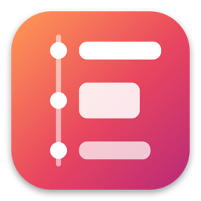
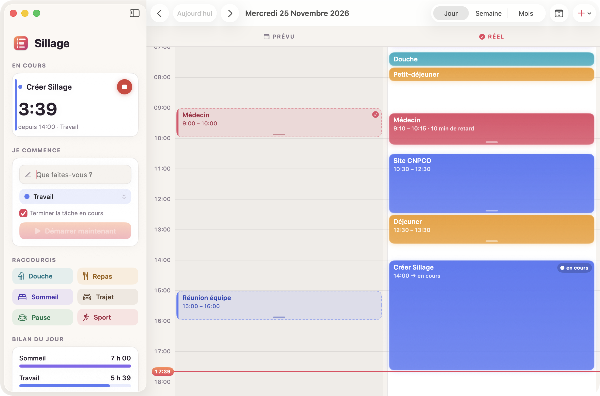
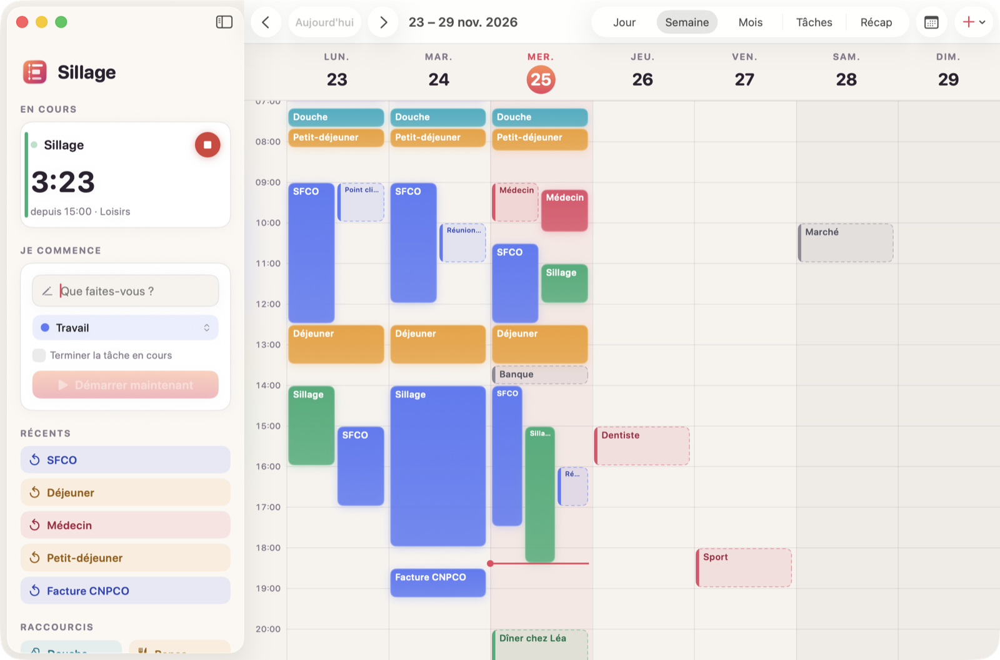
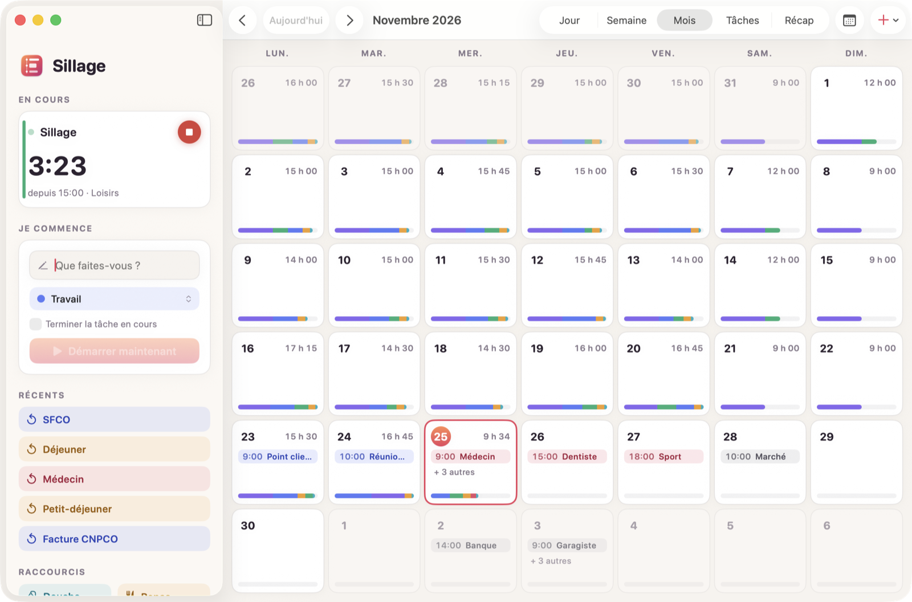
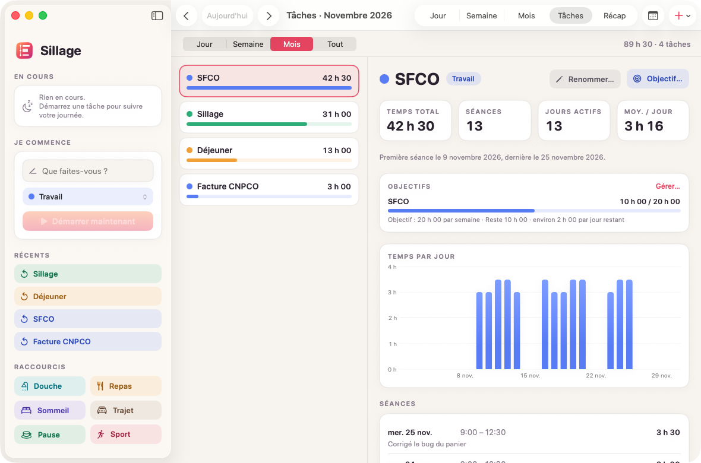
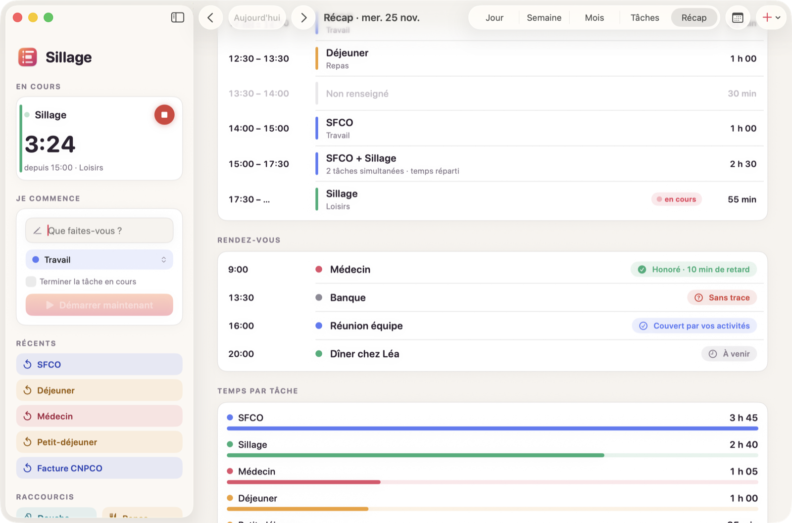
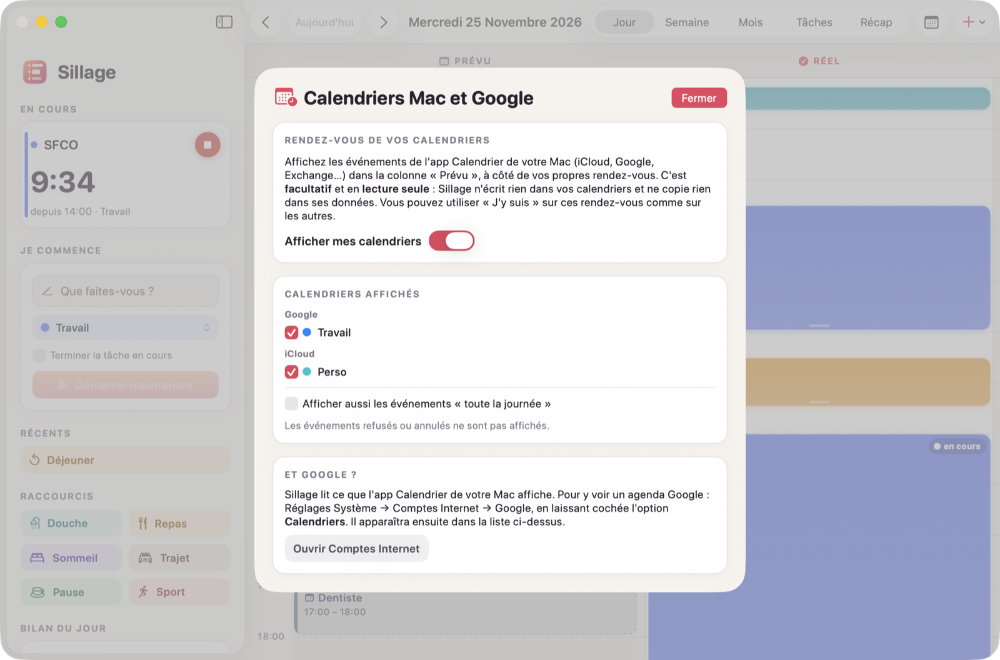
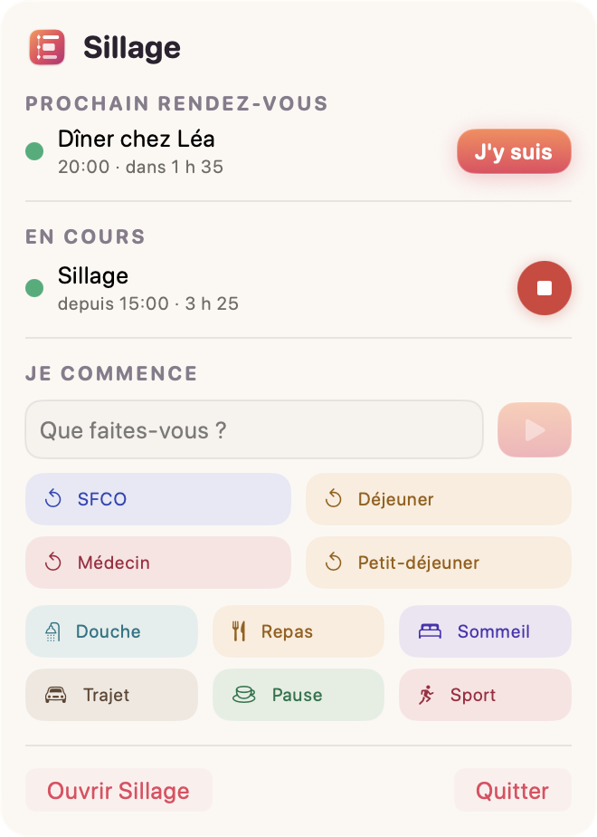
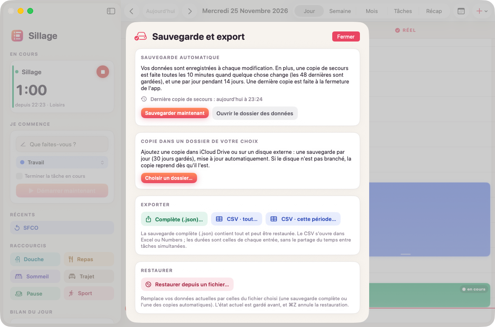

<div align="center">



# Sillage

**Your calendar, plus a record of what you actually did with your day.**

  

[Version française](README.md)



</div>

Sillage is a free, open-source Mac app that combines a **calendar** with a **log of your day**. *(The interface is currently in French.)*

- **Plan** your appointments: the doctor, a meeting… with repetition and reminders.
- **Start a task** the moment you begin it (“I start the app at 4:34 PM”). You don't need to know when it will end: it stays *running* and keeps growing on the timeline until you stop it.
- **Do several things at once**: simultaneous tasks sit side by side and their time is shared.
- **Look back at your day**: from this time to that time, shower, lunch, the website, the appointment. Planned (dashed) and actual (solid) face each other.
- **Know where your time goes**: how much on a given task, for a day, a week, a month, or since forever.

Everything stays **on your Mac**: no account, no network, no data sent anywhere.

## A tour

### The day, as a timeline
Two lanes: **Prévu** (Planned: appointments, tinted with an edge) and **Réel** (Actual: what you did, solid). An appointment honored with “J'y suis” (“I'm here”) shows how early or late you were. Drag in an empty area to create a range, drag a block to move it, stretch its bottom edge to change its duration: everything snaps to 15 minutes.

### Week and month
 

The **week** puts seven days side by side. The **month** gives one card per day: planned appointments and a **colour bar** of the time actually spent, by category.

### Tasks: how long on what


Pick **Jour / Semaine / Mois / Tout** (Day / Week / Month / All time). Tasks with the same title are grouped (“SFCO”, “sfco” and “SFCO” = one task). Click one to see its **total, sessions, active days, average**, a **chart** per day (per week or month over a long period) and the list of its sessions.

### The day recap


Your day told hour by hour, with the **gaps** (“Non renseigné”, not filled in), simultaneous tasks, the outcome of each **appointment** (honored with its delay, covered by your activities, no trace, upcoming) and the **time per task**. **Copier** (Copy) or **Partager** (Share) sends it as text (mail, note, invoice…).

The recap is not a step you must validate: it is **computed continuously** from your data. It is there for today, live, as for any past day. There is **no “End the day” button**: if you go to bed at 9 PM and stop a task the next morning, nothing breaks.

### Your Mac and Google calendars (optional)


If your appointments already live in your Mac's **Calendar** app (iCloud, Google, Exchange…), Sillage can show them in the **Prévu** (Planned) lane, with a small calendar icon, so you can compare planned and actual without retyping anything. **It's an option, off by default**: open it with **⇧⌘K** (or the “Calendriers Mac et Google” line at the bottom of the sidebar), switch it on and accept macOS's permission prompt.

- **Read-only**: Sillage writes nothing into your calendars and copies nothing into its data (nor into backups or exports). These appointments can't be moved or deleted from Sillage; “Ouvrir Calendrier” opens them in the Calendar app.
- **“J'y suis”** (I'm here) works on them like on your own appointments: the real activity starts, the timeline shows the delay, and the recap counts them (“Honoré · 10 min de retard”).
- **You choose which calendars** to show. Declined or cancelled events are hidden, and so are “all-day” ones (a checkbox shows them).
- **Google**: add your account in *System Settings → Internet Accounts → Google* keeping “Calendars” ticked; its calendars then appear in the list.
- Reminders stay those of the Calendar app: Sillage adds none for these appointments.

### In the menu bar


The running task and its timer are always visible. The panel shows the next appointment (with **J'y suis**), stops a task, starts one, resumes a recent task or runs a shortcut, without opening the window. Closing the window keeps Sillage running; **Quitter** (Quit) stops it.

## Usage

### Track your day
| I want to… | I do… |
|---|---|
| Start a task now | Sidebar: title, category, **Démarrer maintenant** (Start now) |
| Launch a common activity (shower, meal, sleep, commute, break, sport) | One click on a **shortcut** |
| Resume a task I already did | **Récents** (Recent) section: one click restarts it with its category |
| Switch from one task to the next | “Terminer la tâche en cours” (Stop the running task) checkbox, on by default |
| Work on two things at once | **Untick** “Terminer la tâche en cours”: both stay running, side by side. The summary **shares the time** between them (two tasks for 3 h: 1 h 30 each), so the total stays the time actually elapsed |
| Stop a task | ■ button on its “En cours” (Running) card |
| Log something already done | **+ → Activité passée** (⇧⌘N) |

Sillage **doesn't guess anything**: a task keeps running until you stop it, even if the Mac sleeps or locks (you may simply be in the shower). A task left “running” for more than 12 h is flagged as probably forgotten, with a way to enter its end time.

### Plan
| I want to… | I do… |
|---|---|
| Add an appointment | **+ → Rendez-vous prévu** (⌘N) |
| Say I've arrived | Right-click the appointment → **J'y suis**: the real task starts and the timeline shows how early or late you were |
| Repeat it (physio every Wednesday, rent every month…) | Sheet → **Répéter** (Repeat): day, week (chosen weekdays), month, year; “every N”; “until”. Each occurrence stays individually editable, movable and honorable; series are extended one year ahead |
| Delete a series | Open an occurrence → **Supprimer** (Delete) → “this occurrence only” or “this and following” (what was already lived is kept) |
| See my Calendar / Google appointments | **⇧⌘K** → turn on “Afficher mes calendriers” (optional, read-only) |
| Be warned | Sheet → **Rappel** (Reminder): at start, 5 min, 15 min, 1 h, 1 day before: macOS notification, even with the window closed |

### View and fix
| I want to… | I do… |
|---|---|
| Change view | **Jour / Semaine / Mois / Tâches / Récap** (Day / Week / Month / Tasks / Recap), ⌘1 to ⌘5 |
| Navigate | ‹ › or ⌘← ⌘→ (one day, week or month depending on the view); today: ⌘T; a specific date: the calendar icon |
| Create, move, stretch a range | **Drag** in an empty part of the timeline, drag a block, stretch its bottom edge |
| Fix a time | Click the block (or the session in the Tasks view, or the recap row) |
| See the summary by category or by task | Sidebar: **Catégories / Tâches**; it follows the displayed period |
| Undo a mistake | **⌘Z** undoes the last change (create, move, delete, stop…), **⇧⌘Z** redoes it |
| Back up, export or restore my data | **⇧⌘B** (or the “Copie de secours à…” line at the bottom of the sidebar): see [Your data](#your-data) |

## Your data

It lives in `~/Library/Application Support/Sillage/data.json` (readable JSON). Every change is written immediately and atomically: a crash mid-write can't corrupt the file. If the file ever becomes unreadable it is set aside (`data.corrompu-…`) and never overwritten. Nothing leaves your Mac, unless you yourself pick a copy folder.



**⇧⌘B** opens the **Sauvegarde et export** (Backup and export) window:

- **Automatic safety copies**: every 10 minutes when something changes (the last 48 are kept), plus one per day for 14 days, plus a last one when the app quits. An incident costs you a few minutes at most. Copies are in `Sauvegardes/`. An unreadable or empty file is never copied.
- **Copy to a folder of your choice** (iCloud Drive, external disk…): one file per day, 30 days kept, updated automatically; if the disk is unplugged, copying resumes as soon as it's back.
- **Export**: a **full backup** (`.json`) or a **CSV** of the whole history or of the displayed period, for Excel or Numbers.
- **Restore** from a full backup or an automatic copy: a confirmation is asked, the current state is kept first (`Sauvegardes/Avant-restauration/`), and **⌘Z** undoes the restore.

## Install

1. Download `Sillage.dmg` from [Releases](../../releases) and drag **Sillage** into *Applications*.
2. The app isn't signed by Apple: on first launch, right-click the app → **Open** → **Open**.

## Build it yourself

Requires Xcode or its command-line tools (macOS 13+, Apple Silicon).

```bash
./build_app.sh   # builds, generates the icon, assembles dist/Sillage.app
./make_dmg.sh    # creates dist/Sillage.dmg
swift test       # core tests
```

The core (`SillageCore`: model, time calculations, series, reports, recap, history) is separate from the SwiftUI interface (`SillageApp`) and covered by tests. No third-party library: only macOS frameworks.

## Ideas for later

- Writing a Sillage appointment into a calendar (today, reading is read-only)
- iCal export
- Custom categories and shortcuts
- Settings window and launch at login
- Global keyboard shortcut to start / stop a task
- “Focus”: say which simultaneous task you're on, for a more precise time split
- Drag and create in the week view

## License

[MIT](LICENSE): free to use, modify and redistribute. © Damien POLLET (Wudstyz)
