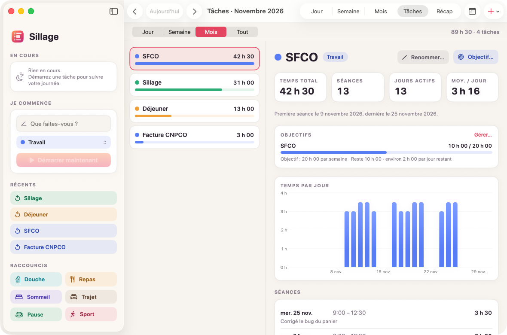
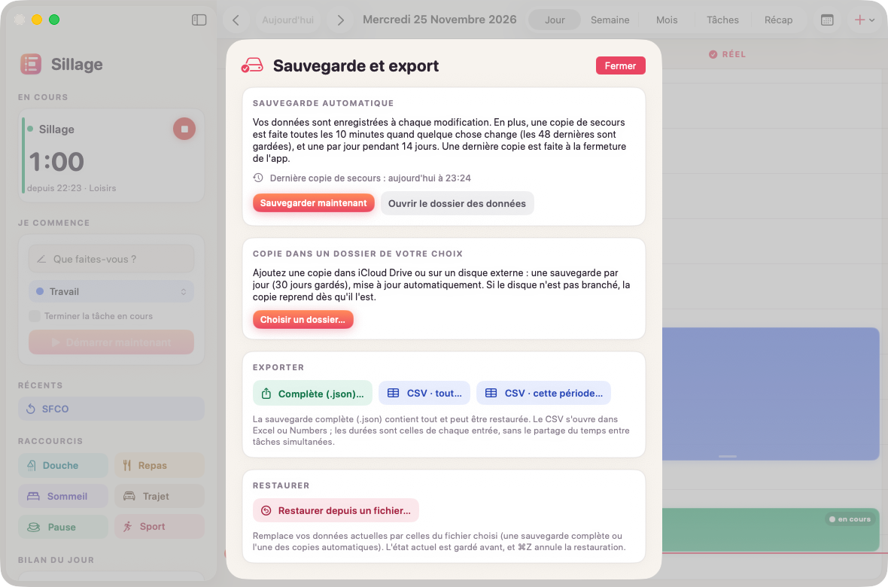

<div align="center">


# Sillage

**Votre agenda, et la trace de ce que vous avez vraiment fait de votre journée.**

  

[English version](README.en.md)


</div>

Sillage est une app Mac gratuite et libre qui réunit un **calendrier** et un **journal de bord de la journée**.

- **Planifiez** vos rendez-vous : le médecin, une réunion… avec répétition et rappels.
- **Démarrez une tâche** à l'instant où vous la commencez (« je commence l'appli à 16 h 34 »). Pas besoin de savoir quand elle finira : elle reste *en cours* et grandit sur la frise jusqu'à ce que vous l'arrêtiez.
- **Faites plusieurs choses à la fois** : les tâches simultanées se placent côte à côte, et leur temps est réparti.
- **Relisez votre journée** : de telle heure à telle heure la douche, le repas, le site, le rendez-vous. Le prévu (en pointillés) et le réel (en plein) sont face à face.
- **Sachez où part votre temps** : combien sur telle tâche, pour un jour, une semaine, un mois, ou depuis toujours.

Tout reste **sur votre Mac** : aucun compte, aucun réseau, aucune donnée envoyée.

## Un aperçu

### La journée, en frise
Deux voies : **Prévu** (rendez-vous, teintés avec un liseré) et **Réel** (ce que vous avez fait, en plein). Un rendez-vous honoré avec « J'y suis » affiche son retard ou son avance. Glissez dans le vide pour créer une plage, glissez un bloc pour le déplacer, étirez son bord bas pour changer sa durée : tout s'aligne sur le quart d'heure.

### La semaine et le mois
 

La **semaine** met sept jours côte à côte. Le **mois** donne une carte par jour : rendez-vous prévus et **barre de couleurs** du temps réellement passé, par catégorie.

### Les tâches : combien de temps sur quoi


Choisissez **Jour / Semaine / Mois / Tout**. Les tâches de même titre sont regroupées (« SFCO », « sfco » et « SFCO » = une seule tâche). Un clic sur l'une montre son **total, ses séances, ses jours actifs, sa moyenne**, un **graphique** par jour (par semaine ou par mois sur une longue période) et la liste de ses séances.

### Le récap de la journée


La journée racontée heure par heure, avec les **trous** (« Non renseigné »), les tâches simultanées, l'état de chaque **rendez-vous** (honoré avec son retard, couvert par vos activités, sans trace, à venir) et le **temps par tâche**. **Copier** ou **Partager** l'envoie en texte (mail, note, facture…).

Le récap n'est pas une étape à valider : il est **calculé en continu** à partir de vos données. Il est là pour aujourd'hui, en direct, comme pour n'importe quel jour passé. Il n'y a **pas de bouton « Terminer la journée »** : si vous vous couchez à 21 h et arrêtez une tâche le lendemain, rien ne casse.

### Dans la barre de menus


La tâche en cours et son chronomètre sont visibles en permanence. Le panneau montre le prochain rendez-vous (avec **J'y suis**), arrête une tâche, en démarre une, reprend une tâche récente ou lance un raccourci, sans ouvrir la fenêtre. Fermer la fenêtre laisse Sillage actif ; **Quitter** l'arrête.

## Utilisation

### Suivre sa journée
| Je veux… | Je fais… |
|---|---|
| Commencer une tâche maintenant | Barre latérale : titre, catégorie, **Démarrer maintenant** |
| Lancer une activité courante (douche, repas, sommeil, trajet, pause, sport) | Un clic sur un **raccourci** |
| Reprendre une tâche déjà faite | Section **Récents** : un clic la relance avec sa catégorie |
| Enchaîner deux tâches | Case « Terminer la tâche en cours » (cochée par défaut) |
| Travailler sur deux choses à la fois | **Décocher** « Terminer la tâche en cours » : les deux restent en cours, côte à côte. Le bilan **répartit le temps** entre elles (deux tâches pendant 3 h : 1 h 30 chacune), donc le total reste le temps réellement écoulé |
| Terminer une tâche | Bouton ■ de sa carte « En cours » |
| Noter une activité déjà passée | **+ → Activité passée** (⇧⌘N) |

Sillage **ne devine rien** : une tâche continue tant que vous ne l'arrêtez pas, même si le Mac s'endort ou se verrouille (vous êtes peut-être simplement parti à la douche). Une tâche restée « en cours » plus de 12 h est signalée comme probablement oubliée, avec la possibilité d'indiquer son heure de fin.

### Planifier
| Je veux… | Je fais… |
|---|---|
| Ajouter un rendez-vous | **+ → Rendez-vous prévu** (⌘N) |
| Signaler que je suis arrivé | Clic droit sur le rendez-vous → **J'y suis** : la tâche réelle démarre et la frise affiche le retard ou l'avance |
| Le répéter (kiné chaque mercredi, loyer chaque mois…) | Fiche → **Répéter** : jour, semaine (jours au choix), mois, année ; « toutes les N » ; « jusqu'au ». Chaque occurrence reste modifiable, déplaçable et honorable séparément ; les séries sont prolongées un an à l'avance |
| Supprimer une série | Fiche d'une occurrence → **Supprimer** → « Cette occurrence seulement » ou « Celle-ci et les suivantes » (ce qui a déjà été vécu reste) |
| Être prévenu | Fiche → **Rappel** (à l'heure, 5 min, 15 min, 1 h, 1 jour avant) : notification macOS, même fenêtre fermée |

### Voir et corriger
| Je veux… | Je fais… |
|---|---|
| Changer de vue | **Jour / Semaine / Mois / Tâches / Récap** (⌘1 à ⌘5) |
| Naviguer | ‹ › ou ⌘← ⌘→ (un jour, une semaine ou un mois selon la vue) ; aujourd'hui : ⌘T ; une date précise : l'icône calendrier |
| Créer, déplacer, étirer une plage | **Glisser** dans le vide de la frise, glisser un bloc, étirer son bord bas |
| Corriger une heure | Clic sur le bloc (ou sur la séance dans la vue Tâches, ou sur la ligne du récap) |
| Voir le bilan par catégorie ou par tâche | Barre latérale : **Catégories / Tâches** ; il suit la période affichée |
| Annuler une erreur | **⌘Z** annule la dernière modification (créer, déplacer, supprimer, terminer…), **⇧⌘Z** la rétablit |
| Sauvegarder, exporter ou restaurer mes données | **⇧⌘B** (ou la ligne « Copie de secours à… » en bas de la barre latérale) : voir [Vos données](#vos-données) |

## Vos données

Elles sont dans `~/Library/Application Support/Sillage/data.json` (JSON lisible). Chaque modification est écrite tout de suite, de façon atomique : un plantage en pleine écriture ne corrompt pas le fichier. Si le fichier devenait illisible, il est mis de côté (`data.corrompu-…`) et jamais écrasé. Rien ne quitte votre Mac, sauf si vous choisissez vous-même un dossier de copie.



**⇧⌘B** ouvre la fenêtre **Sauvegarde et export** :

- **Copies de secours automatiques** : toutes les 10 minutes quand quelque chose change (les 48 dernières sont gardées), plus une par jour pendant 14 jours, plus une dernière à la fermeture de l'app. Un incident ne vous coûte donc que quelques minutes. Les copies sont dans `Sauvegardes/`. Un fichier illisible ou vide n'est jamais copié.
- **Copie dans un dossier de votre choix** (iCloud Drive, disque externe…) : un fichier par jour, 30 jours gardés, mis à jour automatiquement ; si le disque est débranché, la copie reprend dès qu'il revient.
- **Exporter** : une **sauvegarde complète** (`.json`) ou un **CSV** de tout l'historique ou de la période affichée, pour Excel ou Numbers.
- **Restaurer** depuis une sauvegarde complète ou une copie automatique : une confirmation est demandée, l'état actuel est gardé avant (`Sauvegardes/Avant-restauration/`), et **⌘Z** annule la restauration.

## Installation

1. Téléchargez `Sillage.dmg` depuis les [Releases](../../releases) et glissez **Sillage** dans *Applications*.
2. L'app n'est pas signée par Apple : à la première ouverture, faites un clic droit sur l'app → **Ouvrir** → **Ouvrir**.

## Construire soi-même

Prérequis : Xcode ou ses outils en ligne de commande (macOS 13+, Apple Silicon).

```bash
./build_app.sh   # compile, génère l'icône, assemble dist/Sillage.app
./make_dmg.sh    # crée dist/Sillage.dmg
swift test       # tests du cœur
```

Le cœur (`SillageCore` : modèle, calculs du temps, séries, rapports, récap, historique) est séparé de l'interface SwiftUI (`SillageApp`) et couvert par des tests. Aucune bibliothèque tierce : seulement les frameworks de macOS.

## Idées pour la suite

- Lecture de vos calendriers existants (Calendrier, Google…) pour remplir le « Prévu » automatiquement
- Export iCal
- Catégories et raccourcis personnalisés
- Fenêtre de réglages et lancement à la connexion
- Raccourci clavier global pour démarrer / terminer une tâche
- « Focus » : indiquer sur quelle tâche simultanée vous êtes, pour un partage du temps plus précis
- Glisser et créer dans la vue semaine

## Licence

[MIT](LICENSE) : libre d'utilisation, de modification et de redistribution. © Damien POLLET (Wudstyz)
