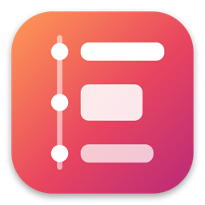

<div align="center">



# Sillage

**Votre agenda, et la trace de ce que vous avez vraiment fait de votre journée.**

  

[English version](README.en.md)


</div>

Sillage est une app Mac gratuite et libre qui réunit un **calendrier** et un **journal de bord de la journée**.

- **Planifiez** vos rendez-vous : le médecin, une réunion… Quoi qu'il arrive, de telle heure à telle heure, vous y êtes.
- **Démarrez une tâche** à l'instant où vous la commencez (« je commence l'appli à 16 h 34 »). Pas besoin de savoir quand elle finira : elle reste *en cours* et grandit sur la frise jusqu'à ce que vous la terminiez.
- **Faites plusieurs choses à la fois** : les tâches simultanées se placent côte à côte.
- **Le soir, relisez votre journée** : de telle heure à telle heure la douche, le repas, le site, le rendez-vous, le coucher. Le prévu (pointillés) et le réel (plein) sont face à face, avec un **bilan par catégorie**.

Tout reste **sur votre Mac** : aucun compte, aucun réseau, aucune donnée envoyée.

## Utilisation

| Je veux… | Je fais… |
|---|---|
| Commencer une tâche maintenant | Panneau de gauche : titre, catégorie, **Démarrer maintenant** |
| Terminer une tâche en cours | Bouton ■ dans « En cours » |
| Ajouter un rendez-vous | **+ → Rendez-vous prévu** (⌘N) |
| Noter une activité déjà passée (douche, repas…) | **+ → Activité passée** (⇧⌘N) |
| Corriger une heure oubliée | Clic sur le bloc dans la frise |
| Changer de jour | ‹ › ou ⌘← ⌘→ ; aujourd'hui : ⌘T |

Les données sont dans `~/Library/Application Support/Sillage/data.json` (JSON lisible, écriture atomique).

## Installation

1. Téléchargez `Sillage.dmg` depuis les [Releases](../../releases) et glissez **Sillage** dans *Applications*.
2. L'app n'est pas signée par Apple : à la première ouverture, faites un clic droit sur l'app → **Ouvrir** → **Ouvrir**.

## Construire soi-même

Prérequis : Xcode ou ses outils en ligne de commande (macOS 13+, Apple Silicon).

```bash
./build_app.sh   # compile, génère l'icône, assemble dist/Sillage.app
./make_dmg.sh    # crée dist/Sillage.dmg
swift test       # tests du cœur
```

Le cœur (`SillageCore`) est séparé de l'interface SwiftUI (`SillageApp`) ; aucune bibliothèque tierce.

## Idées pour la suite

- Vues semaine et mois
- Export / import (JSON, iCal) et lecture de vos calendriers existants
- Catégories personnalisées
- Raccourci global et barre de menus pour démarrer / terminer une tâche
- Récapitulatif de fin de journée

## Licence

[MIT](LICENSE) : libre d'utilisation, de modification et de redistribution. © Damien POLLET (Wudstyz)
