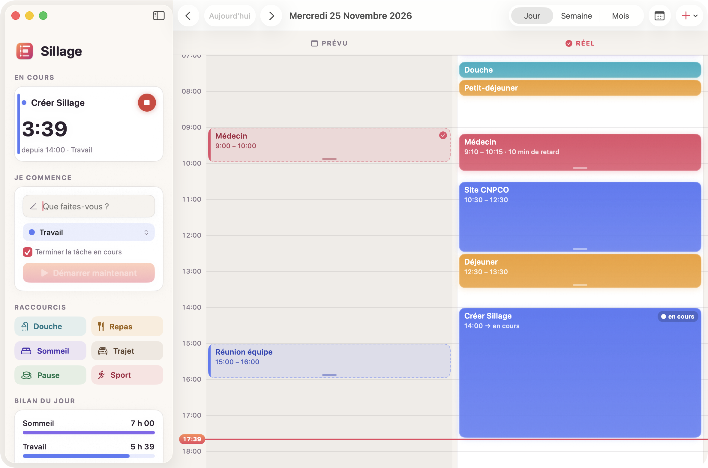
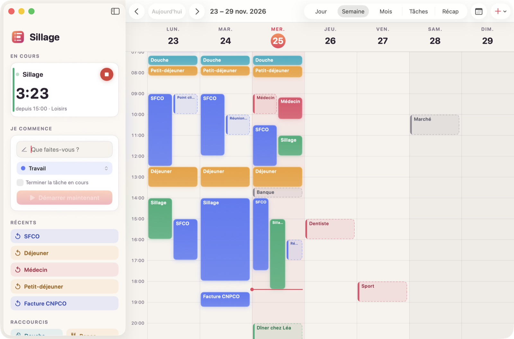
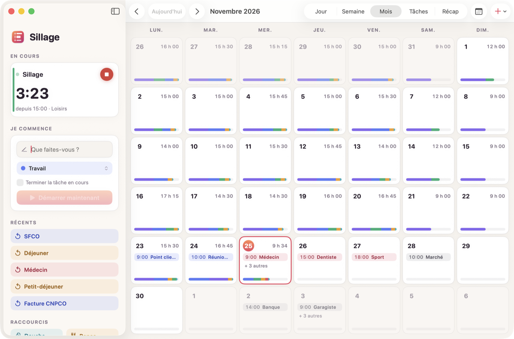
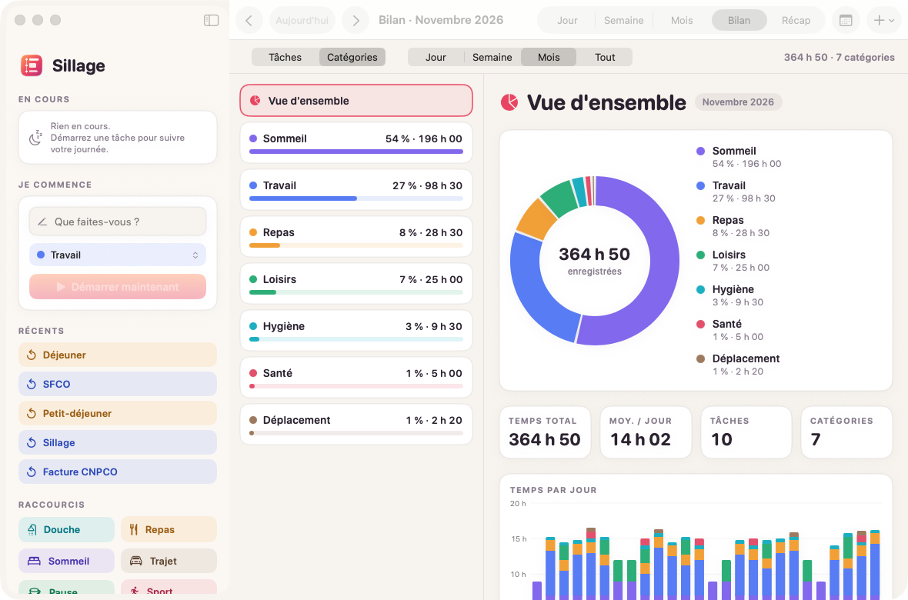
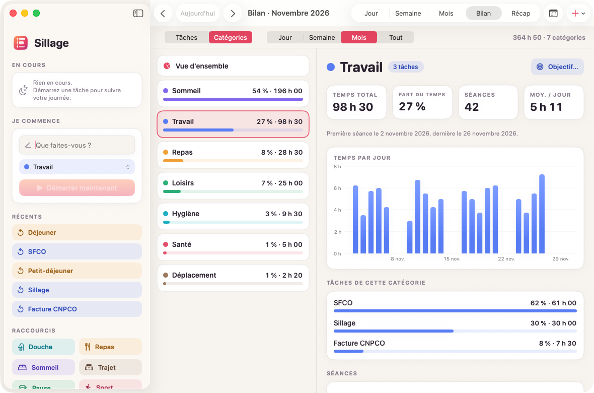
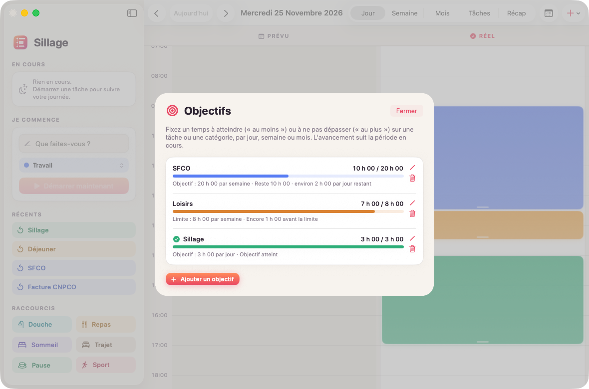
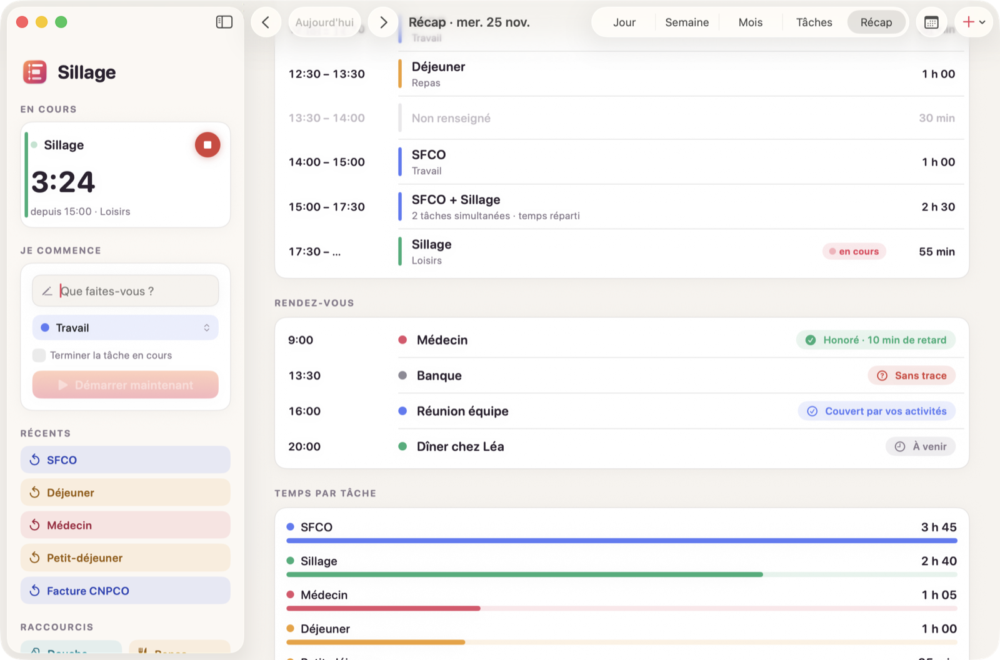
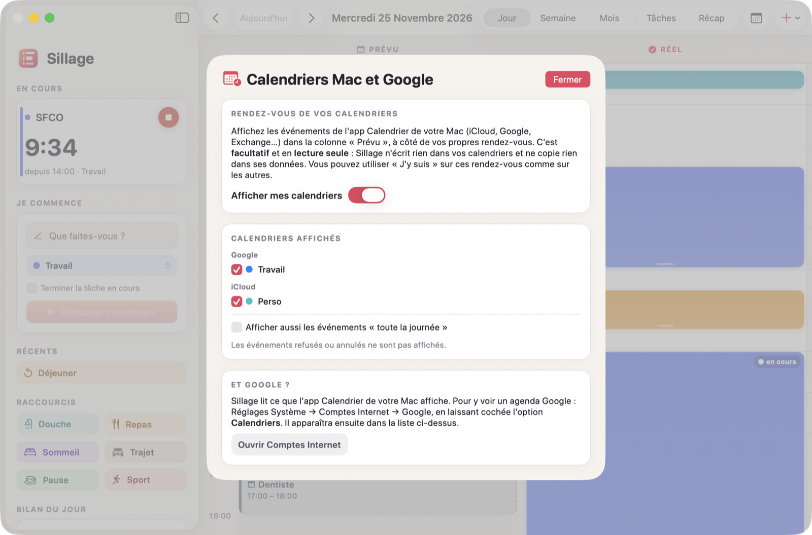

<div align="center">


# Sillage

**Votre agenda, et la trace de ce que vous avez vraiment fait de votre journée.**

  

[English version](README.en.md)



</div>

Sillage est une app Mac gratuite et libre qui réunit un **calendrier** et un **journal de bord de la journée**.

- **Planifiez** vos rendez-vous : le médecin, une réunion… avec répétition et rappels.
- **Démarrez une tâche** à l'instant où vous la commencez (« je commence l'appli à 16 h 34 »). Pas besoin de savoir quand elle finira : elle reste *en cours* et grandit sur la frise jusqu'à ce que vous l'arrêtiez.
- **Faites plusieurs choses à la fois** : les tâches simultanées se placent côte à côte, et leur temps est réparti.
- **Relisez votre journée** : de telle heure à telle heure la douche, le repas, le site, le rendez-vous. Le prévu (en pointillés) et le réel (en plein) sont face à face.
- **Sachez où part votre temps** : combien sur telle tâche, pour un jour, une semaine, un mois, ou depuis toujours.

Tout reste **sur votre Mac** : aucun compte, aucun réseau, aucune donnée envoyée.

## Un aperçu

### La journée, en frise
Deux voies : **Prévu** (rendez-vous, teintés avec un liseré) et **Réel** (ce que vous avez fait, en plein). Un rendez-vous honoré avec « J'y suis » affiche son retard ou son avance. Glissez dans le vide pour créer une plage, glissez un bloc pour le déplacer, étirez son bord bas pour changer sa durée : tout s'aligne sur le quart d'heure.

### La semaine et le mois
 

La **semaine** met sept jours côte à côte. Le **mois** donne une carte par jour : rendez-vous prévus et **barre de couleurs** du temps réellement passé, par catégorie.

### Le bilan : où part votre temps


La vue **Bilan** (⌘4) s'ouvre sur une **vue d'ensemble** : un **camembert** de la répartition du temps, sa légende avec les pourcentages, les chiffres clés et l'évolution jour par jour (empilée par catégorie). Rien à choisir pour tout voir d'un coup d'œil. Deux réglages en haut :

- **Tâches / Catégories** : regrouper par tâche (« SFCO », « Sillage »…) ou par catégorie (Travail, Repas, Sommeil…). Les tâches de même titre sont regroupées (« SFCO », « sfco » et « SFCO » = une seule tâche).
- **Jour / Semaine / Mois / Tout** : la période du camembert et des listes (**Tout** = depuis votre première entrée).

Un clic sur une part du camembert, sur une ligne de la légende ou de la liste ouvre le **détail** ; « Vue d'ensemble » en haut de la liste y ramène. Le détail d'une **tâche** montre son **total, ses séances, ses jours actifs, sa moyenne**, un **graphique** (par jour, ou par semaine / mois sur une longue période) et la liste de ses séances, avec leurs notes.



Le détail d'une **catégorie** donne la même chose, plus sa **part du temps** et les **tâches qui la composent** (un clic ouvre la tâche). Le temps simultané est réparti : la somme des catégories est toujours le temps réellement écoulé. Le **récap du jour** et le bilan de la barre latérale ont eux aussi leur camembert / leurs lignes cliquables par catégorie.

**Renommer… / fusionner** : une faute de frappe (« Sfco »), ou deux noms pour la même chose (« Facture » et « Facture CNPCO ») ? Le bouton **Renommer…** change le nom de toutes les séances d'un coup ; si le nouveau nom est celui d'une autre tâche, elles **fusionnent**. Une catégorie peut être appliquée en même temps, et **⌘Z** annule.

### Vos objectifs


Fixez un temps **à atteindre** (« SFCO : 20 h par semaine ») ou **à ne pas dépasser** (« Loisirs : 8 h par semaine »), sur une **tâche** ou une **catégorie**, par **jour, semaine ou mois**. L'avancement suit la période en cours : jauge, temps restant et, pour une semaine ou un mois, le **rythme à tenir par jour restant**. Une limite presque atteinte passe en orange, dépassée en rouge ; un objectif atteint est coché. Les objectifs s'affichent dans la barre latérale et dans le détail de la tâche. **⇧⌘O** ouvre la fenêtre, ou le bouton **Objectif…** d'une tâche.

### Le récap de la journée


La journée racontée heure par heure, avec les **trous** (« Non renseigné »), les tâches simultanées, l'état de chaque **rendez-vous** (honoré avec son retard, couvert par vos activités, sans trace, à venir) et le **temps par tâche**, avec vos **notes**. **Copier** ou **Partager** l'envoie en texte (mail, note, facture…).

Le récap n'est pas une étape à valider : il est **calculé en continu** à partir de vos données. Il est là pour aujourd'hui, en direct, comme pour n'importe quel jour passé. Il n'y a **pas de bouton « Terminer la journée »** : si vous vous couchez à 21 h et arrêtez une tâche le lendemain, rien ne casse.

### Vos calendriers Mac et Google (facultatif)


Si vos rendez-vous vivent déjà dans l'app **Calendrier** de votre Mac (iCloud, Google, Exchange…), Sillage peut les afficher dans la colonne **Prévu**, avec une petite icône calendrier, pour comparer le prévu et le réel sans rien ressaisir. **C'est une option, désactivée par défaut** : ouvrez-la avec **⇧⌘K** (ou la ligne « Calendriers Mac et Google » en bas de la barre latérale), activez l'interrupteur et acceptez la demande d'autorisation de macOS.

- **Lecture seule** : Sillage n'écrit rien dans vos calendriers et ne copie rien dans ses données (ni dans les sauvegardes ni dans les exports). Ces rendez-vous ne se déplacent ni ne se suppriment depuis Sillage ; « Ouvrir Calendrier » les ouvre dans l'app Calendrier.
- **« J'y suis »** fonctionne dessus comme sur vos rendez-vous : l'activité réelle démarre, la frise affiche le retard, et le récap les compte (« Honoré · 10 min de retard »).
- **Vous choisissez les calendriers** à afficher. Les événements refusés ou annulés sont masqués, ceux « toute la journée » aussi (une case les affiche).
- **Google** : ajoutez votre compte dans *Réglages Système → Comptes Internet → Google* en laissant « Calendriers » coché ; ses agendas apparaissent alors dans la liste.
- Les rappels restent ceux de l'app Calendrier : Sillage n'en ajoute pas pour ces rendez-vous.

### Dans la barre de menus


La tâche en cours et son chronomètre sont visibles en permanence. Le panneau montre le prochain rendez-vous (avec **J'y suis**), arrête une tâche, en démarre une, reprend une tâche récente ou lance un raccourci, sans ouvrir la fenêtre. Fermer la fenêtre laisse Sillage actif ; **Quitter** l'arrête.

## Utilisation

### Suivre sa journée
| Je veux… | Je fais… |
|---|---|
| Commencer une tâche maintenant | Barre latérale : titre, catégorie, **Démarrer maintenant** |
| Lancer une activité courante (douche, repas, sommeil, trajet, pause, sport) | Un clic sur un **raccourci** |
| Reprendre une tâche déjà faite | Section **Récents** : un clic la relance avec sa catégorie |
| Enchaîner deux tâches | Case « Terminer la tâche en cours » (cochée par défaut) |
| Travailler sur deux choses à la fois | **Décocher** « Terminer la tâche en cours » : les deux restent en cours, côte à côte. Le bilan **répartit le temps** entre elles (deux tâches pendant 3 h : 1 h 30 chacune), donc le total reste le temps réellement écoulé |
| Terminer une tâche | Bouton ■ de sa carte « En cours » |
| Noter ce que j'ai fait | Champ **Notes** de la fiche (clic sur un bloc), ou « Ajouter une note… » sur la carte de la tâche en cours. Les notes apparaissent dans la liste des séances, le récap et le CSV |
| Noter une activité déjà passée | **+ → Activité passée** (⇧⌘N) |

Sillage **ne devine rien** : une tâche continue tant que vous ne l'arrêtez pas, même si le Mac s'endort ou se verrouille (vous êtes peut-être simplement parti à la douche). Une tâche restée « en cours » plus de 12 h est signalée comme probablement oubliée, avec la possibilité d'indiquer son heure de fin.

### Planifier
| Je veux… | Je fais… |
|---|---|
| Ajouter un rendez-vous | **+ → Rendez-vous prévu** (⌘N) |
| Signaler que je suis arrivé | Clic droit sur le rendez-vous → **J'y suis** : la tâche réelle démarre et la frise affiche le retard ou l'avance |
| Le répéter (kiné chaque mercredi, loyer chaque mois…) | Fiche → **Répéter** : jour, semaine (jours au choix), mois, année ; « toutes les N » ; « jusqu'au ». Chaque occurrence reste modifiable, déplaçable et honorable séparément ; les séries sont prolongées un an à l'avance |
| Modifier toute une série | Fiche d'une occurrence → **Appliquer à : Celle-ci et les suivantes**. Titre, heure, durée, rappel et note changent pour les suivantes (celles déjà vécues ne bougent pas) ; un changement de jour ne concerne que cette occurrence |
| Supprimer une série | Fiche d'une occurrence → **Supprimer** → « Cette occurrence seulement » ou « Celle-ci et les suivantes » (ce qui a déjà été vécu reste) |
| Voir mes rendez-vous de Calendrier / Google | **⇧⌘K** → activer « Afficher mes calendriers » (facultatif, lecture seule) |
| Être prévenu | Fiche → **Rappel** (à l'heure, 5 min, 15 min, 1 h, 1 jour avant) : notification macOS, même fenêtre fermée |

### Voir et corriger
| Je veux… | Je fais… |
|---|---|
| Changer de vue | **Jour / Semaine / Mois / Bilan / Récap** (⌘1 à ⌘5) |
| Naviguer | ‹ › ou ⌘← ⌘→ (un jour, une semaine ou un mois selon la vue) ; aujourd'hui : ⌘T ; une date précise : l'icône calendrier |
| Créer, déplacer, étirer une plage | **Glisser** dans le vide de la frise, glisser un bloc, étirer son bord bas |
| Corriger une heure | Clic sur le bloc (ou sur la séance dans le Bilan, ou sur la ligne du récap) |
| Corriger un nom de tâche, regrouper deux tâches | Bilan → détail d'une tâche → **Renommer…** (fusionne si le nom existe déjà) |
| Fixer un objectif de temps | Bilan → détail d'une tâche ou d'une catégorie → **Objectif…**, ou **⇧⌘O** |
| Voir où part mon temps, par catégorie ou par tâche | **Bilan** (⌘4) : camembert, **Tâches / Catégories**, **Jour / Semaine / Mois / Tout**. Un résumé suit aussi la période affichée dans la barre latérale |
| Annuler une erreur | **⌘Z** annule la dernière modification (créer, déplacer, supprimer, terminer…), **⇧⌘Z** la rétablit |
| Sauvegarder, exporter ou restaurer mes données | **⇧⌘B** (ou la ligne « Copie de secours à… » en bas de la barre latérale) : voir [Vos données](#vos-données) |

## Vos données

Elles sont dans `~/Library/Application Support/Sillage/data.json` (JSON lisible). Chaque modification est écrite tout de suite, de façon atomique : un plantage en pleine écriture ne corrompt pas le fichier. Si le fichier devenait illisible, il est mis de côté (`data.corrompu-…`) et jamais écrasé. Rien ne quitte votre Mac, sauf si vous choisissez vous-même un dossier de copie.


**⇧⌘B** ouvre la fenêtre **Sauvegarde et export** :

- **Copies de secours automatiques** : toutes les 10 minutes quand quelque chose change (les 48 dernières sont gardées), plus une par jour pendant 14 jours, plus une dernière à la fermeture de l'app. Un incident ne vous coûte donc que quelques minutes. Les copies sont dans `Sauvegardes/`. Un fichier illisible ou vide n'est jamais copié.
- **Copie dans un dossier de votre choix** (iCloud Drive, disque externe…) : un fichier par jour, 30 jours gardés, mis à jour automatiquement ; si le disque est débranché, la copie reprend dès qu'il revient.
- **Exporter** : une **sauvegarde complète** (`.json`, avec vos séries et objectifs) ou un **CSV** de tout l'historique ou de la période affichée (avec les notes), pour Excel ou Numbers.
- **Restaurer** depuis une sauvegarde complète ou une copie automatique : une confirmation est demandée, l'état actuel est gardé avant (`Sauvegardes/Avant-restauration/`), et **⌘Z** annule la restauration.

## Installation

1. Téléchargez `Sillage.dmg` depuis les [Releases](../../releases) et glissez **Sillage** dans *Applications*.
2. L'app n'est pas signée par Apple : à la première ouverture, faites un clic droit sur l'app → **Ouvrir** → **Ouvrir**.

## Construire soi-même

Prérequis : Xcode ou ses outils en ligne de commande (macOS 13+, Apple Silicon).

```bash
./build_app.sh   # compile, génère l'icône, assemble dist/Sillage.app
./make_dmg.sh    # crée dist/Sillage.dmg
swift test       # tests du cœur
```

Le cœur (`SillageCore` : modèle, calculs du temps, séries, rapports, récap, historique) est séparé de l'interface SwiftUI (`SillageApp`) et couvert par des tests. Aucune bibliothèque tierce : seulement les frameworks de macOS.

## Idées pour la suite

- Écrire un rendez-vous de Sillage dans un calendrier (aujourd'hui, la lecture est seule)
- Export iCal
- Catégories et raccourcis personnalisés
- Fenêtre de réglages et lancement à la connexion
- Raccourci clavier global pour démarrer / terminer une tâche
- « Focus » : indiquer sur quelle tâche simultanée vous êtes, pour un partage du temps plus précis
- Glisser et créer dans la vue semaine

## Licence

[MIT](LICENSE) : libre d'utilisation, de modification et de redistribution. © Damien POLLET (Wudstyz)
